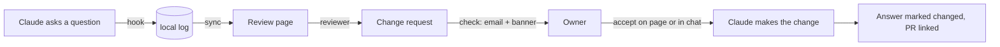

# build-questions: concept

## The problem

Building an app with Claude means answering dozens of small product questions (which database, how people sign
in, what the cancellation policy is, what the button says). The answers live in chat transcripts nobody re-reads.
The people who should weigh in (a client, a partner, a product owner) never see them, and when they disagree weeks
later there's no record of what was decided, when, or why.

## The idea

Treat every question Claude asks as a line in a shared decision log, and let reviewers push back on any line.

## Design choices

1. **Capture by hook, not by habit.** A `PostToolUse` hook on `AskUserQuestion` reads the questions, options and
   answers straight from the tool call. It can't be forgotten. The skill pushes Claude to use `AskUserQuestion` for
   product decisions and to write questions that make sense out of context, and to record the two cases the hook
   can't see: questions asked in plain chat, and decisions Claude made itself ("Decided by Claude"). This pairs with
   build-autopilot's `decide-reversible` mode: what Claude decides without asking still lands on the page for
   review.
2. **Local first, page second.** Hooks can't reach the page, so they append to `~/.build-questions/log/`. Claude
   syncs to the page at the start of work and before ending a turn (the Stop hook reminds once, which matters in
   cloud sessions whose disk disappears).
3. **One page per project.** Reviewers are usually per project (the client for that app), so each repo gets its own
   page with its own sharing. It's a claude.ai artifact with a database: live updates, per-person identity, access
   rules, no server to run.
4. **The owner decides; reviewers request.** A request never changes code by itself. The owner accepts or keeps it
   on the page or in chat; only then does Claude act. Reviewer text is treated as data. The owner's decision in chat
   is itself an `AskUserQuestion`, so it is recorded too.
5. **History, not overwrite.** A changed answer keeps the old one (shown struck through) and links the request and
   the PR that made the change.
6. **Email without a server.** The page can't send mail and nothing runs when a reviewer clicks, so email goes out on
   the next `check`: an hourly scheduled task, plus the start of any Claude session in the repo. The page shows the
   request to the owner immediately. Sending is pluggable (Resend, SMTP, or a GitHub @-mention as the zero-setup
   fallback); keys stay in environment variables, and the address lives in the local config and in an Editors-only
   document on the page so a fresh cloud session can find it.

## Open questions for you

- **Repo home.** Built in `shorconsulting/marketplace` under `plugins/build-questions`, because this session can't
  create a new repo. Your other plugins each have their own repo; to match, create an empty
  `shorconsulting/build-questions` and move this folder there, then point the marketplace entry at it.
- **Email path.** Resend is the default recommendation. Fine, or would you rather standardise on SMTP from your
  Google Workspace, or route through something you already run?
- **Reviewer access.** Requesting needs Contributor access on the artifact. Should Commenters be able to request too?
  (That would mean using artifact comments instead of the page's own form.)
- **Faster email.** Hourly is the floor without a server. If minutes matter, a small webhook (Cloudflare Worker) could
  send on write; that's a v2 item.
- **One page per repo vs one per client.** A client with several repos might want one page covering them all; the
  store already records `repo` on every question, so this is a page change, not a data change.
- **Export to the repo.** `export` writes `docs/build-questions.md` on demand. Should it run automatically and be
  committed with each sync, so the log lives in git too?
